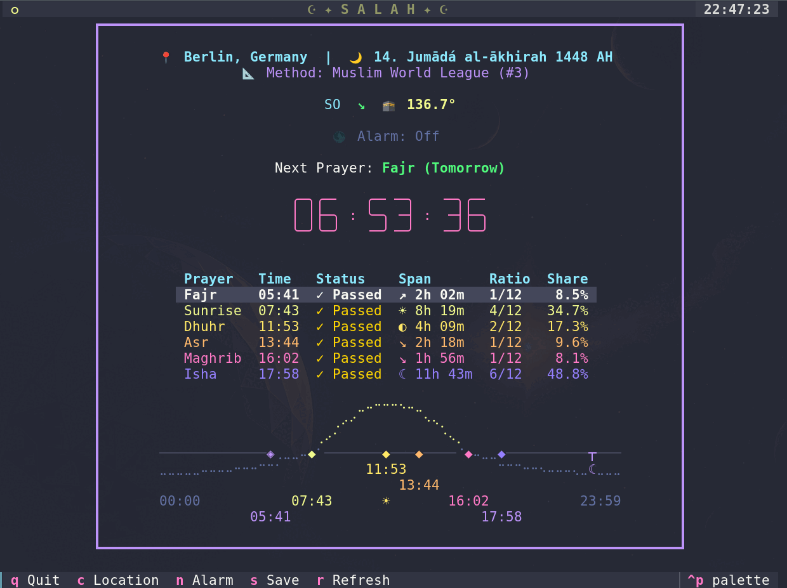

# ⚡ RAW INTERFACE _

### 🧠 NO FILTERS. NO LECTURES. JUST RAW DATA.

* *“In a world of synthetics, clean syntax is the only truth left.”* 🚀

---

  

### 📂 DIRECTORY // PYTHON TUIs (PyPI)
* `L [TUI]` **[asma-tui](https://github.com/postsonde/asma-tui/)** [PyPi](https://https://pypi.org/project/asma-tui/) — Learn the 99 Qualities of Allah (`$ pipx install asma-tui`)
* `L [TUI]` **[salah-tui](https://github.com/postsonde/salah-tui)** [PyPi](https://pypi.org/project/salah-tui/) — Islamic prayer times & sun tracking (`$ pipx install salah-tui`)
* `L [TUI]` **[quran-tui](https://github.com/postsonde/quran-tui)** [PyPi](https://pypi.org/project/quran-tui/) — Holy Quran study & translations (`$ pipx install quran-tui`)
* `L [TUI]` **[hijri-tui](https://github.com/postsonde/hijri-tui)** [PyPi](https://pypi.org/project/hijri-tui/) — Hijri calendar & lunar phases (`$ pipx install hijri-tui`)
* `L [TUI]` **[zazen-tui](https://github.com/postsonde/zazen-tui)** [PyPi](https://pypi.org/project/zazen-tui/) — Minimalist Zazen meditation TUI (`$ pipx install zazen-tui`)
* `L [TUI]` **[goabase-tui](https://github.com/postsonde/goabase-tui)** [PyPi](https://pypi.org/project/goabase-tui/) — Goa & Psytrance parties browser (`$ pipx install goabase-tui`)

---

### 🐚 DIRECTORY // BASH LAUNCHERS & CONKY

* `L [Bash]` **[newsboat-banner](https://github.com/postsonde/newsboat-banner)** — ANSI Rainbow ASCII launcher for `newsboat`
* `L [Bash]` **[ytfzf-banner](https://github.com/postsonde/ytfzf-banner)** — Pastel ASCII launcher for `ytfzf`
* `L [Theme]` **[conky-all-in-one-dracula-theme](https://github.com/postsonde/conky-all-in-one-dracula-theme)** — Dual-widget Conky setup in Dracula colors

---

### 🎲 DIRECTORY // GNU BACKGAMMON THEMES

* `L [3D Theme]` **[GNU-Backgammon-3D-Dracula-Theme](https://github.com/postsonde/GNU-BACKGAMMON-3D-Dracula-Theme)** — 3D board theme for GNU Backgammon
* `L [2D Theme]` **[GNU-Backgammon-Dracula-Theme](https://github.com/postsonde/GNU-BACKGAMMON-Dracula-Theme)** — Modern color scheme for GNU Backgammon

---

`[Status: Active | Host: postsonde | Web: postsonde.github.io | License: GNU GPLv3 | Protocol: Simulated Gemini/Web Hybrid]`
